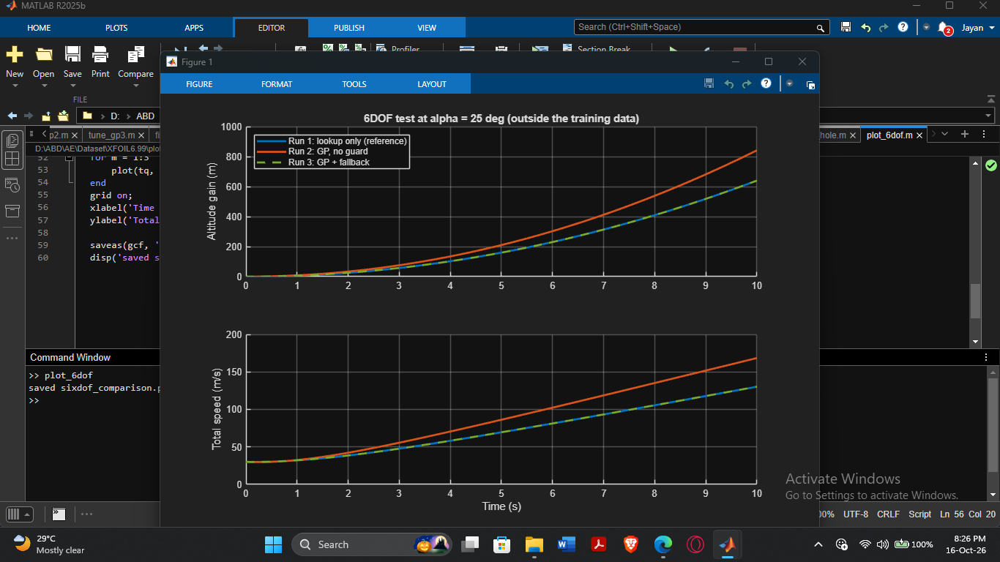

# Confidence-Aware Fallback for a Learned Aerodynamic Surrogate: A Case Study on the NACA 0012 Airfoil

## Question

Can a learned aerodynamic model know when not to be trusted?

## What this project does

- Generates NACA 0012 airfoil data (CL, CD, CM) with XFOIL 6.99, for angles of attack from -5 to 15 degrees and Mach 0 to 0.4 (Reynolds number 1,000,000).
- Trains a Gaussian Process (GP) surrogate from scratch in MATLAB, with no toolbox. It gives a prediction and an uncertainty value.
- Uses the uncertainty to decide when to trust the GP. If the uncertainty is above 0.00879, a lookup table built from the same XFOIL data is used instead.
- Tests this inside a Simulink 6DOF model, in three runs: lookup only, GP with no guard, and GP with fallback.

All limits, settings and test rules were written down and pushed before the tests were run. See the `docs` folder.

## Final GP settings

- Quadratic trend in angle of attack and Mach, with a GP on what the trend misses.
- Squared-exponential kernel: sf = 0.1, ls = 0.4, sn = 0.001.
- Inputs and outputs are standardized.
- Settings were tuned on a validation slice (train up to 9 degrees, validate on 9 to 12 degrees). The test data was not used for tuning.

## What worked

- The GP beat a degree-2 polynomial on held-out data (random 80/20 split). CL error was about 12 times smaller.
- When an early version of the GP was tested on angles it had never seen (12 to 15 degrees), its uncertainty rose with the real error. The correlation was 0.97 to 0.99 for CL and CM.
- The uncertainty threshold (0.00879) was set on development data, with a safety margin. On 29 new near-stall points (15.5 to 18 degrees), every point it trusted had a CL error of 0.1 or less. It trusted 5 of 29 and refused all 10 points with CL error above 0.1.
- Inside Simulink, the GP gave an uncertainty of 0.0006 at 2 degrees and 0.1 at 25 degrees. The fallback switch picked the GP in the first case and the lookup table in the second.
- In the 6DOF test at 25 degrees (see `docs/screenshots/sixdof_scoring_results.png`):
  - Lookup only (reference): passed all limits.
  - GP with no guard: failed. Altitude differed by 201.5 m and total speed by 29.3 percent.
  - GP with fallback: passed. It matched the reference.

## What did not work

- The GP did not beat a simple range rule. At 25 degrees, a rule such as "use the lookup above 15 degrees" would have made the same choice. In the hole test (10 to 14 degrees removed from training), a rule that trusts everything inside -5 to 15 degrees made no mistake, because no point had a CL error above 0.1.
- In the hole test, the GP refused 30 of 44 points that were actually accurate. It was cautious, not more useful than the range rule.
- The GP did not predict CD reliably on angles above its training range. No setting I tried fixed this. A log-space variant was rejected because its results were unstable.
- The GP uncertainty depends mainly on distance from the training data. At a given angle it was the same for every Mach number, so it cannot detect a change in the physics by itself. At 15 degrees, three points had almost the same uncertainty but different errors.
- The GP uncertainty is a warning signal, not a calibrated error bar. In the first extrapolation test, the real error was about 100 times larger than the uncertainty claimed.

## Limits

- One airfoil (NACA 0012), with XFOIL simulation data only. XFOIL is less reliable near and past stall. One point (17 degrees, Mach 0.3) did not converge.
- The lookup table is built from the same XFOIL data. It is a bounded default, not a correct answer outside the data.
- The 12 times improvement over the polynomial used a noise setting that was chosen while looking at the test rows. Treat it as an upper estimate.
- The threshold 0.00879 and the 0.1 CL tolerance are placeholders. They are not from a real aircraft specification.
- The 6DOF model is simple. The forces are computed with a fixed airspeed of 30 m/s, even though the aircraft's speed changes during the run. The angle of attack is fixed, and there is no tail, no thrust and no pitching moment. Pitch stays at 0 in every run, so the pitch limit was not tested in any useful way.
- The 6DOF result at 25 degrees is one test point. The fallback matched the reference because it always picked the lookup there. This shows that the switch works. It does not show that the lookup is correct.
- The GP runs inside Simulink through an extrinsic MATLAB call. It cannot be turned into code for flight hardware without more work.

## Future work

- Test more airfoils and more data sources.
- Add a tail and a closed loop, so pitch and angle of attack come from the aircraft motion.
- Make the GP block self-contained so it supports code generation.
- Find a test case where GP uncertainty catches errors that a range rule misses.

## Repository contents

- `data/` - XFOIL results (`raw/`), the training set `naca0012_data.csv`, and the near-stall test set `naca0012_hi_test.csv`.
- `scripts/` - MATLAB scripts and Simulink models. Key files: `gp_predict.m`, `lookup_predict.m`, `score_hi.m`, `score_hole.m`, `score_6dof.m`, `plot_6dof.m`, `aircraft_6dof_gp.slx`.
- `docs/` - locked rules (`safety_limits.md`, `aircraft_assumptions.md`, `hole_test_rules.md`) and result screenshots.

Built using XFOIL 6.99 (Mark Drela, MIT) and MATLAB/Simulink R2025b.