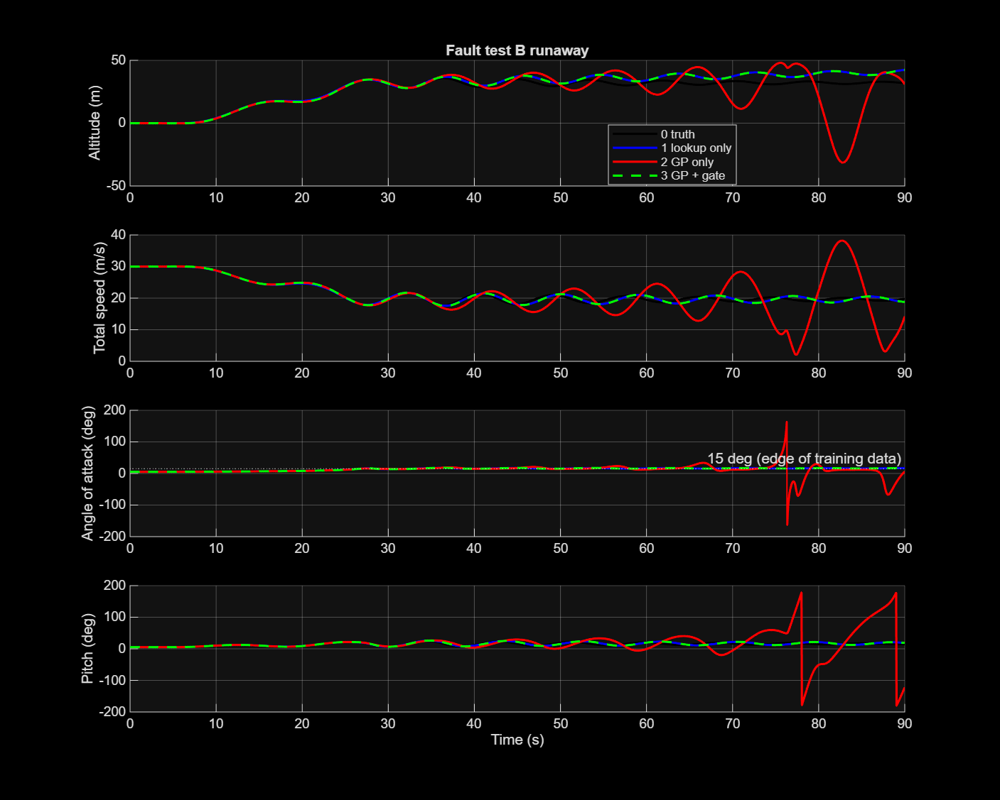
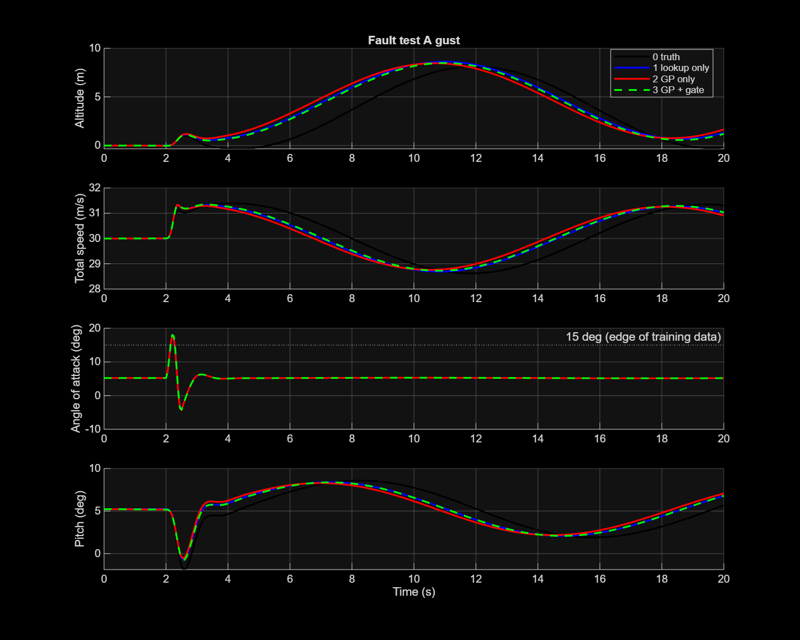
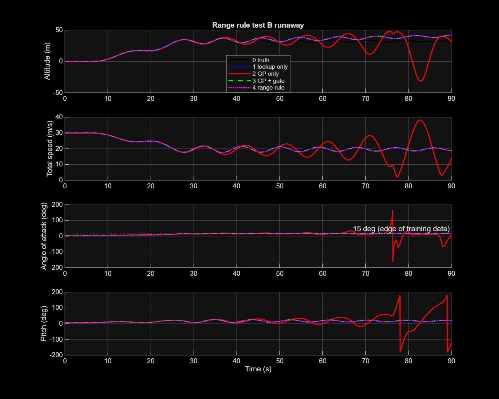

# Confidence-Aware Fallback for a Learned Aerodynamic Surrogate: A Case Study on the NACA 0012 Airfoil

**Status:** core study complete (Nov 2026). Extension in progress, one locked test at a time (see "Next").

## Question

Can a learned aerodynamic model know when not to be trusted, and does its uncertainty give a better trade-off than a simple range rule?

## Main result

In a pre-registered, blind closed-loop fault test (a slow nose-up trim runaway that held the aircraft near stall for about 60 s), the Gaussian Process (GP) alone **lost control** at about 76 s: pitch reached 180 deg and altitude drifted 62.6 m from the truth run. With the **uncertainty gate**, the aircraft stayed under control. Near stall, however, the gate behaved like a simple range rule, and the fallback lookup itself drifted 10.5 m from the truth run, just over the 10 m limit. A follow-up flight test with the range rule as its own mode confirmed this: the gate and the range rule gave almost the same flight (Result 2).

## What this project does

- Generates NACA 0012 data (CL, CD, CM) with XFOIL 6.99 for angles of attack from -5 to 15 deg and Mach 0 to 0.4 (Reynolds number 1,000,000).
- Trains GP surrogates from scratch in MATLAB, with no toolbox. Each GP gives a prediction and an uncertainty value.
- Uses the uncertainty to decide when to trust the GP. Above a locked threshold, a lookup table built from the same XFOIL data is used instead.
- Compares the gate with a simple range rule in a blind offline test.
- Tests the gate in a closed-loop Simulink 6DOF model with injected faults, scored against a **truth model** built from near-stall XFOIL data (15.5 to 18 deg) that neither the GP nor the lookup was trained on.

All limits, settings and test rules were written down and pushed before each test was run. See the `docs` folder and the commit history.

## Results

### 1. Closed-loop fault tests (docs/fault_test_rules.md, docs/fault_test_output.txt)

Four runs per test: truth (reference), lookup only, GP only, GP with gate. Limits: pitch within 30 deg, altitude within 10 m and speed within 20% of the truth run.

**Test B: slow trim runaway (blind)**

| Mode | Max pitch | Altitude diff | Speed diff | Result |
|---|---|---|---|---|
| Truth | 25.1 deg | - | - | Reference (peak angle 16.9 deg, 58.7 s above 15 deg) |
| Lookup only | 25.8 deg | 10.49 m | 6.9% | Fails altitude (just) |
| GP only | 179.8 deg | 62.59 m | 90.0% | Loss of control |
| GP with gate | 26.1 deg | 10.47 m | 7.0% | Fails altitude (just) |

- The gate refused the GP for 58.4 s, exactly while the angle was above 15 deg.
- Above 15 deg the GP does not know the airfoil stalls. It predicts more lift than the truth (for example CL 1.47 against 1.32 at 17 deg), and over a long stay near stall the error grows until the aircraft departs.

**Test A: gust (realistic case; predicted offline before the run, so not blind)**

Upward 1-cos gust, peak 10 m/s, 0.5 s. All modes pass. Altitude differences: lookup 2.39 m, GP only 2.85 m, gate 2.28 m. The angle stayed above 15 deg for only 0.15 s, so the gust barely tests the models.

### 2. Range rule in flight (docs/range_rule_rules.md, docs/range_test_output.txt)

The same two fault tests were run with a fifth mode, the range rule: the GP is used only inside its training data (angle -5 to 15 deg, Mach 0 to 0.4); otherwise the lookup is used. Modes 0 to 3 were run again and matched the earlier numbers exactly.

| Mode | Test A altitude diff | Test B altitude diff | Test B max pitch | GP refused in Test B |
|---|---|---|---|---|
| GP with gate | 2.28 m | 10.47 m (fail) | 26.1 deg | 58.38 s |
| Range rule | 2.27 m | 10.45 m (fail) | 25.9 deg | 58.92 s |

- With dense training data, the gate gave no benefit over the range rule. The two switched within 0.6 s of each other.
- Both failed Test B by about the same margin as the lookup alone (10.49 m). Near stall, the quality of the fallback decided the result, not the switching rule.

### 3. Detector test: GP gate vs range rule, offline, blind (docs/detector_test_rules.md)

GP trained on a sparse grid (32 rows); settings chosen by marginal likelihood on training rows only.

| Test set | Range rule | GP gate |
|---|---|---|
| Inside the range (129 points) | Accepted all 129 | Accepted all 129 (same decisions) |
| Near stall (29 points) | Accepted 0 | Accepted 11: 10 accurate, 1 with CL error 0.1245 (tolerance 0.1) |

The gate gave more coverage but was not safer. No validation point had a large error, so the threshold came from the backup rule.

### 4. Closed-loop model checks

- Angle of attack and airspeed come from the aircraft's own velocity. Gravity uses the current attitude.
- Trim at 30 m/s (angle 5.222 deg, thrust 2.392 N, with airframe drag CD 0.02) flew level.
- An illustrative tail (restoring moment and damping) was added. A pitch nudge settled, so the model is stable.
- Finding: the first GP refused itself in normal cruise, because cruise Mach (0.088) lies between the data's Mach lines. A flight GP with separate length scales for angle and Mach fixed this (docs/flight_gp_rules.md).

### 5. Earlier offline and open-loop results

- The GP beat a degree-2 polynomial on held-out data (CL error about 12 times smaller; noise setting chosen while looking at the test rows, so treat as an upper estimate).
- On 29 near-stall points, the original gate trusted 5 points, all accurate, and refused all 10 bad ones.
- A hole test (10 to 14 deg removed) found no CL error above 0.1, so it could not show a benefit over the range rule.
- An earlier open-loop 6DOF test with fixed angle and speed is kept for the record (docs/screenshots/sixdof_comparison.png). The closed-loop tests replace it.

## What did not work

- The gate was not shown to be better than a simple range rule, offline or in flight. In flight, the range rule gave the same result (Result 2).
- The fallback is not valid beyond its data. It holds its 15 deg values and drifted past a limit in Test B.
- The GP uncertainty is a warning signal, not a calibrated error bar (real errors were up to about 100 times larger than claimed in an early test).
- CD is predicted poorly outside the data. The gate is tuned on CL error only.

## Limits

- One airfoil, XFOIL data only. XFOIL is less reliable near and past stall. Truth data stops at 18 deg.
- Thresholds, tolerances, limits, aircraft numbers (5 kg, 0.15 m2 wing) and the tail model are placeholders, not from a real aircraft.
- Each fault test was run once.
- The fault-test script was first stopped by hand before showing any result, because the variable-step solver stalled. It was rerun once with a fixed-step solver (ode4).
- The flight GP threshold has not been checked on a held-out set.
- `score_hole.m` and `score_patch.m` computed the input scaling from all rows, including test rows (inputs only, not answers). They were not rerun, because their test sets were already used. The detector test uses training rows only.
- The GP runs in Simulink through an extrinsic MATLAB call, so it cannot be compiled for flight hardware as it stands.

A full list of claims, counter-evidence and untested conditions is in `docs/safety_case.md`.

## Next

Extension: find when an uncertainty gate beats a range rule, and what makes the fallback safe. Each step has its own locked rules.

1. Range rule as its own flight mode (done, Result 2).
2. Smooth blend between the GP and the lookup instead of a hard switch.
3. Switching back with two thresholds, and counting switches.
4. An alarm based on uncertainty added up over time.
5. A conformal (calibrated) threshold.
6. A physics-based post-stall fallback.
7. Many random fault runs instead of one.
8. Sparse training data with gaps inside the envelope.
9. A gate that weighs uncertainty by its likely effect on the flight.

## How to reproduce

Requires MATLAB/Simulink R2025b with Aerospace Blockset.

1. Copy `data/naca0012_data.csv` and `data/naca0012_hi_test.csv` into the `scripts` folder, and run everything from there.
2. `make_gp_final` builds the original GP. `make_gp_flight` builds the flight GP.
3. `score_detector` runs the detector test.
4. `score_faults` runs both fault tests. It opens `aircraft_6dof_cl.slx`, whose trim script (`trim_cl.m`) runs automatically.
5. `score_range` runs both fault tests again with the range rule added (mode 4).

`train_gp.m` is an early version kept for history.

## Repository contents

- `data/` - XFOIL results (`raw/`), training set, near-stall test set, detector test points.
- `scripts/` - MATLAB scripts and Simulink models.
- `docs/` - locked test rules, aircraft assumptions, safety case, fault test output and figures.

Built using XFOIL 6.99 (Mark Drela, MIT) and MATLAB/Simulink R2025b.